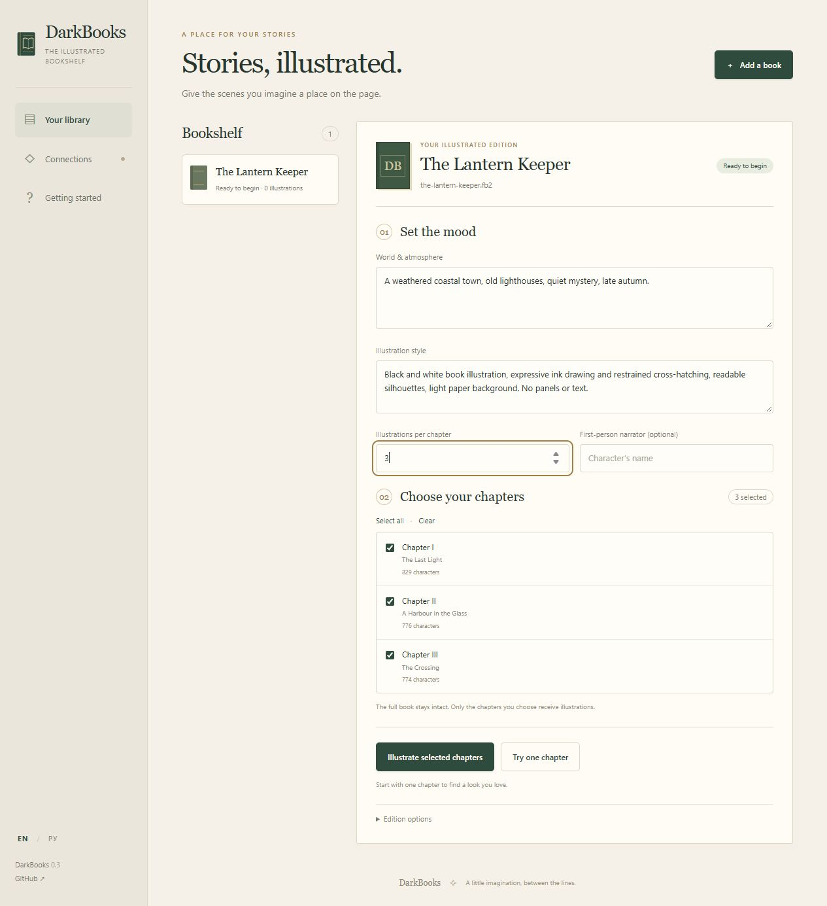

<p align="center"></p>

<h1 align="center">DarkBooks</h1>
<p align="center">A little imagination, between the lines.</p>
<p align="center"><a href="https://github.com/DarkDan81/DarkBooks/releases/latest/download/DarkBooks-Windows-x64.zip"><b>Download for Windows</b></a> · <a href="docs/GETTING_STARTED.md">Getting started</a> · <a href="docs/README.ru.md">Русский</a></p>

Turn an FB2 book into an illustrated edition you can read on your phone. Choose
the chapters, describe the world, pick an illustration style, and let your models
bring the scenes to life.

DarkBooks runs on your computer and opens in your browser. Connect local models
through **LM Studio + ComfyUI**, use compatible cloud APIs, or mix both.



## Start in a few minutes

1. **[Download the Windows ZIP](https://github.com/DarkDan81/DarkBooks/releases/latest/download/DarkBooks-Windows-x64.zip).**
2. Extract the entire folder somewhere writable. Open **`Start.cmd`** inside it.
3. Open **Connections** and connect your text and image models.
4. Add an **FB2** book, or choose **Explore a sample**.
5. Set the mood and choose **Try one chapter**. When you like the result, illustrate
   your selected chapters and download the finished book.

Python and the application's dependencies are included in the Windows download.
**Model weights and model servers are not included.** For local generation,
install LM Studio and ComfyUI; for cloud generation, bring compatible APIs and
your own keys. DarkBooks itself does not need an account.

**Need the exact model files, folder locations or API settings?**
Follow the [step-by-step connection guide](docs/GETTING_STARTED.md).

## What you can do

- Choose chapters, atmosphere, illustration style and a first-person narrator.
- Let the text model select scenes and write source-grounded drawing descriptions.
- Review a separate sample edition before processing the whole book.
- Pause and resume with saved chapter analysis, requests and rendered images.
- Browse illustrations, download them as a ZIP, and export an illustrated FB2.
- Switch between **English and Russian** without changing your book or prompts.
- Replace models or supply your own ComfyUI API workflow.

Your original book is preserved. Unselected chapters remain in the exported book.
Illustration counts are a target: chapters with fewer suitable scenes get fewer images.

## Where this project is today

DarkBooks is an **early experimental release**. The local engine was exercised on
a full collection: 340 illustrations across three novels and two stories. The
new browser app is also covered by end-to-end tests using local test APIs,
including pause/resume and FB2 validation.

It is useful, but it is not a professional illustrator. Models can misread props,
poses or character identities. Faces may vary between scenes. Automatic face
replacement is deliberately **not part of the web app**. Start with a sample
chapter and judge the result yourself.

Current input/output: **FB2**. Exported illustrations are grayscale. EPUB/PDF
conversion, cost estimates and provider-specific cloud presets are not included.
The generic cloud adapters have automated contract tests; individual external
services still need to be checked with your own model and credentials.

## Privacy and running costs

Books and projects live in the local `data` folder. API keys are saved locally in
`data/settings.json`, **in plain text**, and excluded from source control and
release packages. Do not share your populated `data` folder.

The selected model servers receive the text, prompts and images required for
their tasks. Cloud services may charge for these requests. DarkBooks does not
include credits or automatically estimate your bill.

## Run from source

Python **3.11+** is required. The prebuilt portable download is Windows x64; source
code can also be used on Linux and macOS with separately running model servers.

```bash
git clone https://github.com/DarkDan81/DarkBooks.git
cd DarkBooks
python -m venv .venv
```

Activate the environment: `.venv\Scripts\activate` on Windows, or
`source .venv/bin/activate` on Linux/macOS. Then:

```bash
python -m pip install -e .
python launch.py
```

The app opens on localhost. If the default port is busy, it chooses a free one.
For a custom port: `python launch.py --port 8766`. Use `--no-browser` to start
without opening a tab. Set `DARKBOOKS_DATA` to choose a different data folder.

## Contribute or adapt it

See [the adapter guide](docs/ADAPTERS.md), [development notes](CONTRIBUTING.md),
and [release history](CHANGELOG.md). Bug reports, useful workflows and small
improvements are welcome. Please do not attach private books or API keys to issues.

DarkBooks code is released under the [MIT license](LICENSE). Model weights and
bundled third-party dependencies keep their own licenses.
