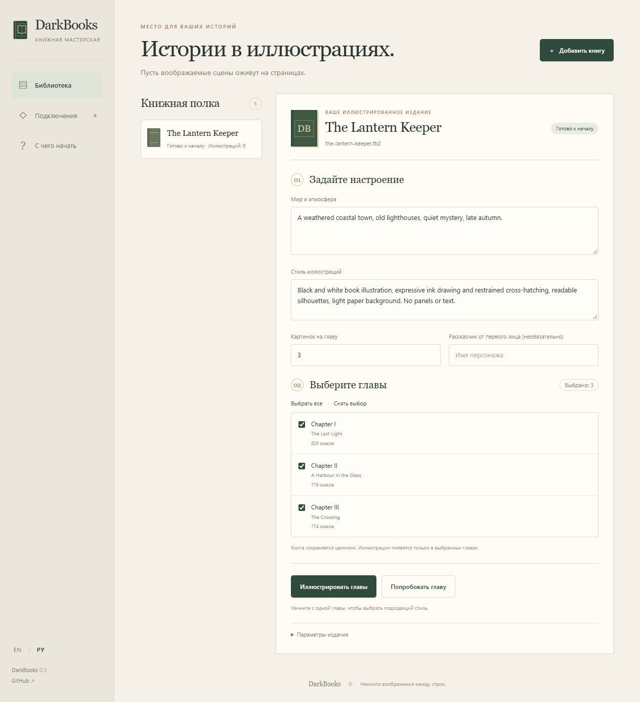

# DarkBooks

**Немного воображения между строк.**

[English](../README.md) · [Скачать для Windows](https://github.com/DarkDan81/DarkBooks/releases/latest/download/DarkBooks-Windows-x64.zip) · [Руководство](GETTING_STARTED.ru.md)

DarkBooks превращает FB2-книгу в иллюстрированное издание для вашей читалки.
Выберите главы, опишите мир и стиль рисунков — модели подберут сцены и нарисуют их.
Приложение запускается на компьютере, интерфейс открывается в браузере.



## Быстрый запуск

1. Скачайте Windows-архив по ссылке выше и распакуйте целиком.
2. Откройте **Start.cmd**. Python и зависимости уже включены.
3. Нажмите **РУ** в боковой панели, если нужен русский интерфейс.
4. В «Подключениях» настройте текстовую и рисующую модели.
5. Добавьте FB2 или откройте пример. Задайте оформление и попробуйте одну главу.

**Модели и их серверы не входят в архив.** Для локальной работы нужны LM Studio
и ComfyUI с весами. Можно подключить совместимые облачные API или сочетать оба режима.
Подробная настройка: [пошаговое руководство](GETTING_STARTED.ru.md).

## Возможности

- Выбор глав, общего промпта мира, стиля и рассказчика от первого лица.
- Автоматический выбор сцен и подготовка описаний на основе текста книги.
- Отдельное пробное издание перед полным запуском.
- Остановка и продолжение с сохранённых результатов.
- Галерея, скачивание картинок ZIP и готовой FB2.
- Английский и русский интерфейсы; свои модели и ComfyUI workflow.

Книга сохраняется целиком. Невыбранные главы останутся без новых иллюстраций.
Количество картинок — ориентир, а не обязательная квота.

## Ограничения первой версии

Это ранний экспериментальный проект. Движок использовался для создания 340
иллюстраций по трём романам и двум рассказам. Веб-приложение проверяется тестами
полного цикла, включая паузу, продолжение и проверку FB2.

Модели могут ошибаться в предметах, позах и внешности персонажей. Лица между
сценами могут различаться; автоматическая замена лиц не входит в веб-версию.
Поддерживается **FB2**; EPUB/PDF и подсчёта стоимости пока нет. Иллюстрации в
книге чёрно-белые. Совместимость конкретного облачного сервиса нужно проверить
своими моделью и ключом на одной главе.

## Ваши данные

Проекты хранятся в `data`, ключи — открытым текстом в `data/settings.json`.
Не публикуйте заполненную папку данных. В релизы и Git она не попадает.
Выбранные серверы моделей получают текст и промпты для генерации; облачные
провайдеры могут брать плату. Приложение не включает оплаченные запросы.

## Из исходников

Нужен Python 3.11+. Создайте виртуальное окружение, активируйте его и выполните:

```shell
git clone https://github.com/DarkDan81/DarkBooks.git
cd DarkBooks
python -m pip install -e .
python launch.py
```

Исходники можно использовать на Windows, Linux и macOS с отдельно запущенными
серверами моделей; готовый portable-архив предназначен для Windows x64.

Код распространяется по [MIT](../LICENSE). Лицензии весов и сторонних зависимостей
сохраняются отдельно. [Предложения и ошибки](https://github.com/DarkDan81/DarkBooks/issues) приветствуются.
